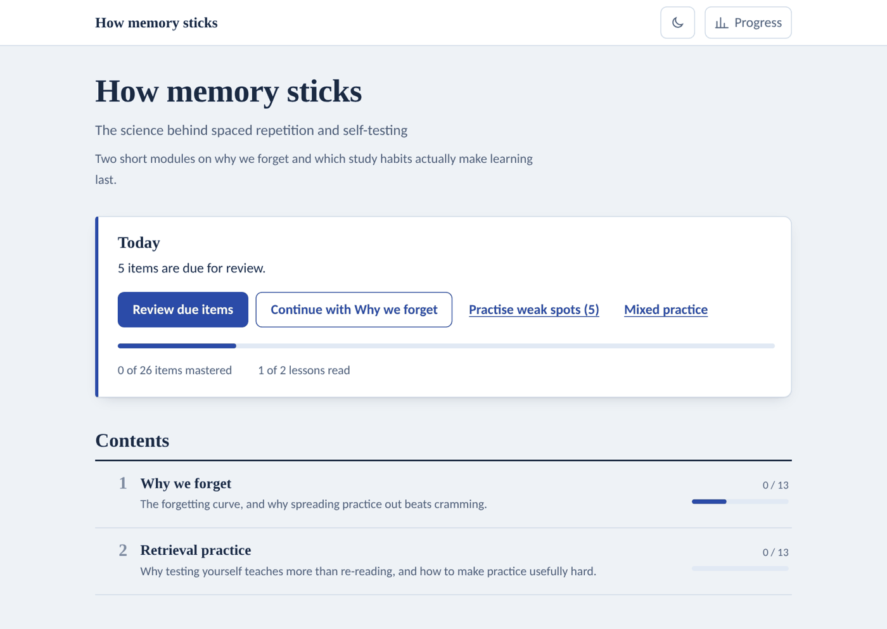
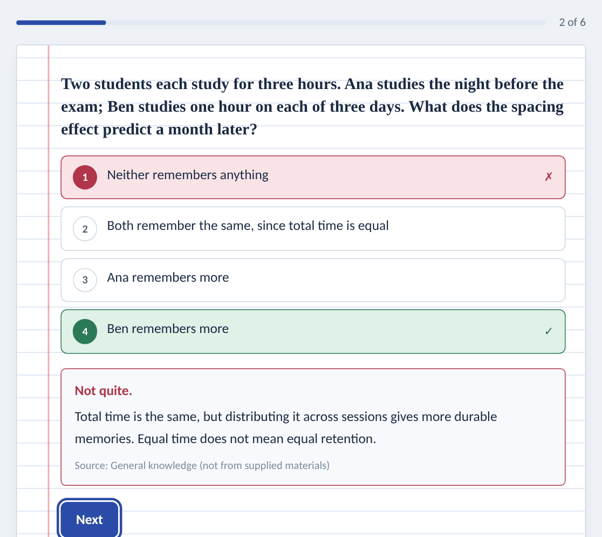
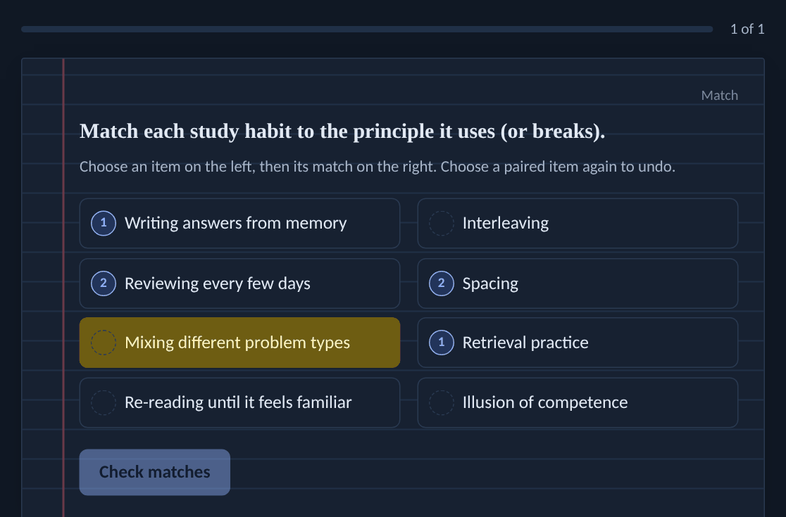

# Interactive Learning Studio

Turn course materials — or just a topic — into a single-file interactive learning
website that works offline: lessons, quizzes, flashcards with spaced repetition,
active-recall prompts, matching practice, a "due today" review and progress tracking.



## Install

**Claude app (web, desktop, Cowork)**: once the plugin is listed in Anthropic's
directory, find *Interactive Learning Studio* under **Customize → Plugins → Discover**
(or at [claude.com/plugins](https://claude.com/plugins)) and click **Add**.

**Claude Code**, from Anthropic's community marketplace:

```
/plugin marketplace add anthropics/claude-plugins-community
/plugin install interactive-learning-studio@claude-community
```

Or straight from this repository:

```
/plugin install interactive-learning-studio --marketplace DataNinja101/interactive-learning-studio
```

## Use it

Attach your notes, slides or PDFs and ask, for example:

- "Turn these lecture notes into a learning site."
- "Make an interactive course on the basics of spaced repetition."
- "Make a question bank from these PDFs so I can check the questions first."
- "Add a module on chapter 5 to the learning site you built last week."

Claude writes the lessons and practice items, builds the site, checks it in a headless
browser when one is available, and sends you the `.html` file.

## Skills

| Skill | What it does |
|-------|--------------|
| `interactive-learning-studio` | Plans the course, writes lessons and practice, builds and browser-checks the site. Also updates sites it built earlier without losing learners' progress. |
| `question-bank-builder` | Extracts page-numbered text from PDF, Word, PowerPoint, Excel and web pages, writes source-cited questions, flashcards and recall prompts, and produces a review report with an answer key and coverage gaps before any site is built. |

For large materials the site builder runs the question bank builder first, so the
questions can be reviewed before the site is made.

## What learners get

| | |
|---|---|
|  |  |

- One `.html` file: download, double-click, works without internet.
- Per module: Lesson, Quiz, Flashcards, Recall and Match tabs.
- A dashboard with items due for review, weak spots, mixed practice and progress.
- Progress saved in the browser; Export/Import progress moves it between devices.
- Light and dark themes, phone-friendly layout, keyboard shortcuts.
- English or Greek interface; other languages through translated labels.
- Every answer can show the source and page it came from.

## How it works

The site engine (`skills/interactive-learning-studio/assets/template.html`) is fixed and
tested. Claude only writes course content as JSON in the format described in
`references/data-schema.md`; `scripts/build_site.py` validates it and embeds it in the
engine. Content is inserted as text, never as HTML, so course material cannot inject
scripts into the page.

```
skills/interactive-learning-studio/
  SKILL.md                     site-building workflow
  assets/template.html         the site engine
  scripts/build_site.py        validate, build, and extract data from a built site
  scripts/smoke_test.py        headless-browser check of every module and tab
  references/data-schema.md    course JSON format shared by both skills
  references/ui-strings.md     interface labels for translation
  examples/sample-course.json  complete example course
skills/question-bank-builder/
  SKILL.md                     question-bank workflow
  scripts/extract_sources.py   page-marked text from PDF, DOCX, PPTX, XLSX, HTML, TXT
  scripts/bank_report.py       quality checks, source coverage and answer key
  references/question-writing.md  how to write good practice items
```

## Requirements

Python 3; the standard library is enough to build sites. Optional, for better
extraction: `pdfplumber` or `pypdf`, `python-docx`, `python-pptx` (fallbacks exist for
these) and `openpyxl` (needed for Excel). Optional, for the browser check: Playwright
with Chromium.

## Privacy

No data collection, analytics or network requests. Sites keep progress in the
learner's own browser. See [PRIVACY.md](PRIVACY.md).

## Licence

MIT © 2026 Creaitive Studio. See [LICENSE](LICENSE).

Issues and suggestions: [github.com/DataNinja101/interactive-learning-studio/issues](https://github.com/DataNinja101/interactive-learning-studio/issues)
